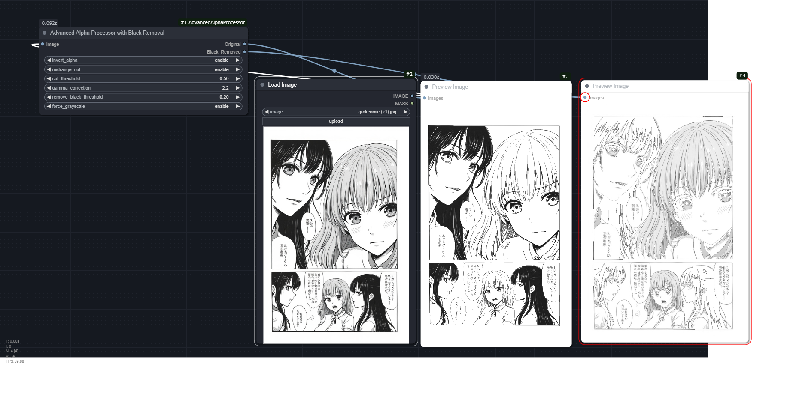

# ComfyUI-AdvancedAlphaProcessor

画像の明るさから透明度を作るComfyUIカスタムノードです。白背景の透過、グレースケール化、黒領域の除去、連番画像の一括処理に対応します。



## インストール

ComfyUIの`custom_nodes`フォルダーで実行します。

```sh
git clone https://github.com/852wa/ComfyUI-AAP.git
```

必要に応じて**ComfyUIが使用しているPython環境**に`requirements.txt`をインストールし、ComfyUIを再起動してください。ポータブル版では同梱のPythonを使用します。既存のGPU用PyTorchを別環境のものに入れ替えないようにしてください。

修正版をZIPから導入する場合は、展開した`ComfyUI-AAP`フォルダーを`custom_nodes`内に配置します。同じノードの旧版を別名フォルダーで残すと重複登録されるため、既存フォルダーを更新してください。

ノードは`Image Processing` → **Advanced Alpha Processor with Black Removal**にあります。

## 使い方

1. `Load Image`の`IMAGE`を本ノードの`image`へ接続します。
2. 元画像の透明度も保持したい場合は、`Load Image`の`MASK`を`mask`へ接続します。
3. PNG保存・ほかの画像との合成には`alpha_mode=straight`を選択します。旧版の見た目を維持する場合は初期値の`legacy`を使用します。
4. `Output`または`Black_Removed`を`Preview Image`や`Save Image`へ接続します。

従来のワークフローは[example.json](example.json)、透明度マスクと`straight`を使う例は[example_straight.json](example_straight.json)です。ComfyUIへ読み込み、`Load Image`で処理する画像を選択してください。

出力をマスクとして利用する場合は、標準の**Split Image with Alpha**へ接続してください。RGB画像と透明度マスク（1が透明）に分離できます。この動作は[ComfyUIの実装](https://github.com/comfyanonymous/ComfyUI/blob/master/comfy_extras/nodes_compositing.py)に合わせています。

## 設定

| 設定 | 初期値 | 動作 |
| --- | --- | --- |
| `invert_alpha` | enable | 明るい部分を透明、暗い部分を不透明にします。disableでは逆になります。 |
| `midrange_cut` | disable | enableで生成アルファを二値化します。しきい値以上は1、未満は0です。 |
| `cut_threshold` | 0.5 | 二値化のしきい値。`midrange_cut=disable`では使用しません。 |
| `gamma_correction` | 2.2 | RGBのガンマ処理に使用する指数（1.0〜3.0）。グレースケール変換の前に累乗し、出力時に逆変換します。生成アルファ自体には作用しません。 |
| `remove_black_threshold` | 0.15 | 入力RGBの全チャンネルがこの値未満の画素を、`Black_Removed`側で透明にします。0で除去なし。境界値と等しい画素は残ります。 |
| `force_grayscale` | enable | ガンマ処理したRGBからグレースケールを生成します。disableでカラーを保持します。 |
| `alpha_mode` | legacy | `legacy`は旧版のRGB計算。`straight`はRGBを透明度で暗くしないPNG・合成向けの方式です。 |
| `mask` | 未接続 | 任意の透明度マスク。0が不透明、1が透明です。生成アルファに`1 - mask`を掛けます。 |

### 出力

- `Output`：生成した透明度を持つRGBA画像。
- `Black_Removed`：さらに黒領域を透明にしたRGBA画像。

どちらも形状は`[枚数, 高さ, 幅, 4]`、画素値は0〜1のfloat32です。完全に透明な画素のRGBは0になります。

### 透明度とガンマの計算

元のRGBに対して`0.299R + 0.587G + 0.114B`で明るさを求め、反転・二値化を適用します。その後、入力RGBAのアルファと任意の`1 - mask`を掛けます。元画像の透明度は二値化しないので、透明な部分が復活することはありません。

グレースケール化はガンマ処理後のRGBに対して`0.2126R + 0.7152G + 0.0722B`を使います。

`legacy`は`(処理済みRGB × アルファ)^(1 / gamma)`、`straight`は`処理済みRGB^(1 / gamma)`をRGB出力に使います。`legacy`ではRGB自体が暗くなるため、通常のアルファ合成で輪郭がさらに暗くなる場合があります。`straight`ではこの減衰を避けます。カラー保持の`straight`ではガンマ処理と逆変換が相殺され、RGBの色は基本的に変わりません。

## 入力と互換性

- 画像は`[枚数, 高さ, 幅, チャンネル数]`の浮動小数点テンソルを受け取ります。RGB、RGBA、1チャンネルのグレースケールに対応します。RGBAはRGBにアルファを乗算していない形式を想定します。
- CPU・CUDA上で動作し、画像の入力デバイスを維持します。float16、bfloat16、float32、float64入力をfloat32で計算します。
- マスクは`[高さ, 幅]`または`[枚数, 高さ, 幅]`です。1枚のマスクは全フレームで共有し、それ以外は画像と同じ枚数が必要です。サイズが違う場合は画像サイズへバイリニア補間します。
- `Load Image`は通常RGB画像と透明度マスクを別々に出力するため、元の透過を保持するにはMASKも接続してください。RGBAとMASKの両方に同じ透明度を渡すと二重に掛かるため、重ねて適用する意図がある場合に使用してください。
- 入力は変更しません。画素値は0〜1に制限し、NaNと負の無限大を0、正の無限大を1として扱います。空画像・整数画像・不正な形状や設定値には説明付きエラーを返します。
- 既存のノードID・設定順・出力順は維持しています。通常のRGB画像は`legacy`で旧版と数値誤差の範囲で一致します。RGBA入力は、旧版で無視されていた透明度を反映するようになります。

## 開発・テスト

ComfyUIを起動せずに回帰テストを実行できます。開発用Python環境に依存関係とテスト用ライブラリーを用意し、リポジトリ直下で実行してください。

```sh
python -m pip install -r requirements.txt
python -m pip install pytest Pillow
python -m pytest -q
```

CPUでの旧版比較、しきい値境界、RGBA保持、PNGの保存・合成、バッチ、マスク、不正入力を検証します。CUDAが利用できる環境ではGPU比較も実行し、利用できない環境ではGPUテストのみスキップします。GitHub ActionsではPython 3.10 / 3.12でCPUテストを実行します。

変更内容は[CHANGELOG.md](CHANGELOG.md)を参照してください。
